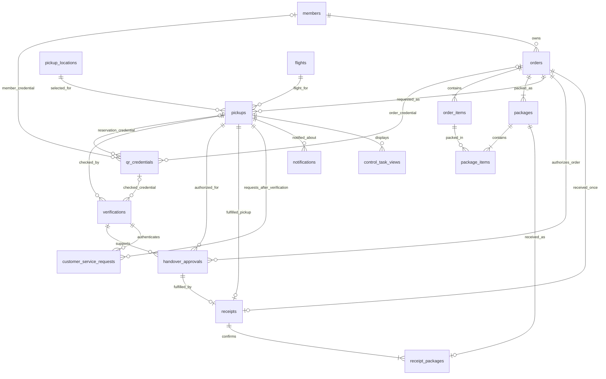
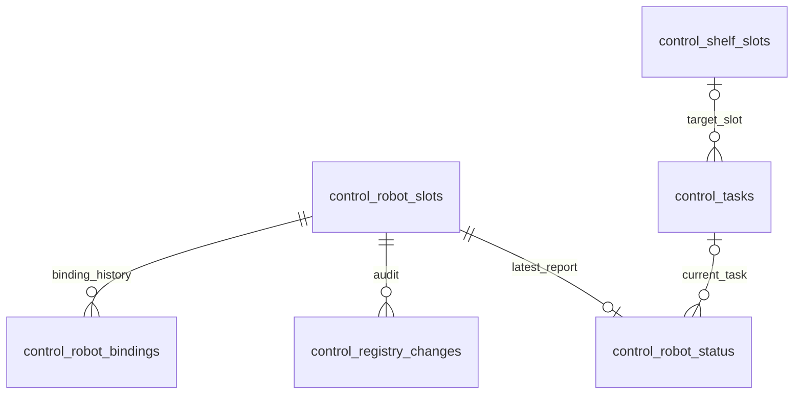

# 서비스·관제 PostgreSQL ERD 설계안

상태: **검토용 v0.2 · 2026-11-07**(v0.1에 회의 결과 반영). 이 문서의 신규 테이블·필드·제약은 제안이며, 적용된 DB 또는 확정 API 계약을 뜻하지 않는다. 현재 구현된 것은 PR #34에서 가져온 관제 registry 4개 테이블뿐이다(검토한 작업 트리 HEAD `91e57e5` 기준이며, 다른 개발자의 로컬·미커밋 스키마와 실제 DB 적용 여부는 확인하지 않았다). 서비스 서버는 health scaffold이며 업무 DB·인증은 미구현이다. 이 설계 작업에서는 DB·마이그레이션·제품 코드를 변경하지 않는다.

v0.2 요약: **서비스 DB는 기존 17개 테이블을 모두 미리 구축**하고(기능·화면은 우선순위대로 나중), **관제 운영 DB는 상태 공유에 필요한 최소 3개 테이블만** 추가한다. 두 DB의 범위가 다른 것은 의도다.

## 1. 범위와 설계 선택

서비스 DB는 고객·주문·상품·포장 구성·예약·인도 승인·실제 수령의 원본이다. 관제 DB는 등록과 **현재 선반·작업·로봇 상태의 공유본**이다. 두 서버는 각자의 DB만 갱신하고 WSS 메시지로 동기화한다(동기화는 후속). 고객 UI와 관제 UI는 API를 통해 조회·변경한다.

- 채택한 기준안: PostgreSQL **논리 DB 2개**와 별도 접속 역할. 같은 인스턴스로 시작할 수 있고 이후 다른 인스턴스로 분리할 수 있다. DB 사이 FK·직접 JOIN·공유 쓰기는 사용하지 않는다.
- 한 DB에 모든 테이블을 두는 안은 기존 ERD와 가깝지만 배포·권한·원본 소유권을 강하게 결합하므로 선택하지 않았다.
- 로컬 개발 후 private IP 전용 클라우드로 배포한다는 사용자 방향을 반영한다. 클라우드 제품·네트워크·백업·실제 인스턴스 수는 이 문서에서 확정하지 않는다.
- 기존 현장 DB 배치 명세와 클라우드 배치 방향은 차이가 있다. 관제 DB의 WAN 단절 중 저장/실행 정책은 배포 전 별도 확정해야 한다. DB commit이 불가능하면 새 물리 명령을 승인하지 않으며 재접속만으로 결과 불명 작업을 재실행하지 않는다.
- **관제 DB는 "선반에 올려진 상품, 입고/출고 여부, 요청한 유저, OMX·Pinky 작업 상태"를 공유하는 데 필요한 정보만 테이블로 관리한다.** 명령 실행·복구·메시지 재전송용 테이블은 실행부와 WSS를 구현할 때 다시 설계한다(5절, 6절).

업무 흐름: 구매 완료된 더미 주문 → 포장 구성 검증 → 예약 접수 → 관제 작업 수락 → 창고·선반·카트 운송 → QR/대체 절차 검증 → 인도 승인 → 실제 회수 확인 → 수령 기록 → 잔여 로봇 복귀. 결제·상품 카탈로그·얼굴 인식·부분 수령·다중 관제는 이번 기본 모델에 포함하지 않는다.

## 2. 출처와 기존 ERD에서 바꿀 사항

2026-11-07 live 조회 기준이다. 문서 버전은 이 설계가 참조한 시점이며 구현 완료 근거가 아니다. 읽은 버전: User Requirements v30, System Requirements v36(SR-01~11, SR-14~18, SR-20~25), SD-01 v4, SD-03 v12, 서비스·관제 통신 v8, 통합관제 v6, Interface Specification(comm) v5. 기존 ERD 이미지와 PR #34 원문은 직접 대조하지 않았다.

- [User Requirements v30](https://fp-team1.atlassian.net/wiki/spaces/MFS/pages/2260995) · [System Requirements v36](https://fp-team1.atlassian.net/wiki/spaces/MFS/pages/2293766) · [SD-01 v4](https://fp-team1.atlassian.net/wiki/spaces/MFS/pages/8060929) · [SD-03 v12](https://fp-team1.atlassian.net/wiki/spaces/MFS/pages/6651917) · [서비스·관제 통신 v8](https://fp-team1.atlassian.net/wiki/spaces/MFS/pages/10125388) · [통합관제 v6](https://fp-team1.atlassian.net/wiki/spaces/MFS/pages/12746754) · [Interface Specification (comm)](https://fp-team1.atlassian.net/wiki/spaces/MFS/pages/17530882)
- [PR #34](https://github.com/kernel-robot-8th/kernel-robot-repo-1/pull/34), 원본 head `ddb8dfa4c4af68aef339c8bcb92e02bab34739ae`; 현재 registry DDL(`services/roport-control-server/src/roport_control_server/adapters/db/001_registry.sql`, PR #34).

| 기존 항목 | 새 설계에서의 처리 |
| --- | --- |
| MEMBERS / ADMINS / FLIGHTS / ORDERS / ORDER_ITEMS | 서비스에 유지. 항공편은 운항일을 포함하고 예약에도 연결한다. |
| PACKAGES / PACKAGE_ITEMS | 상품·포장 구성은 서비스 원본. 실제 선반 위치·로봇 상태는 관제로 이동한다. |
| PICKUPS.gate_escort | 제거. SR-05에 따라 예약 때 선택하지 않고 입국장 인증 후 `customer_service_requests`에 기록한다. 통신 v8의 예약 `escort_requested` 예시는 개정 필요다. |
| PICKUPS.handover_type=SHELF | SR-19에서 삭제된 고객 직접 인도 분기는 활성 모델에서 제외한다. 선반은 중간 물류 보관 위치로 유지한다. |
| PICKUPS.status / received_at | 예약 상태·인증·인도 승인·실제 receipt·관제 진행 사본을 분리한다. |
| MEMBERS.flight_id | 예약에 `flight_id`와 당시 항공편 revision을 연결한다. 회원 정보 변경이 과거 예약을 바꾸지 않는다. |
| ROBOTS / TASKS / TASK_EVENTS / ERROR_LOGS / STORAGE_SLOTS | 관제 소유. v1은 `control_robot_status`, `control_tasks`, `control_shelf_slots`로 줄인다. 단계·실행·명령·이벤트 분리 모델은 후속이다. |
| face_embedding / raw member_qr / raw order_qr | 얼굴 특징은 제외. QR 비밀 원문 대신 토큰 해시·범위·교체/폐기 기록을 보존한다. |
| total_package_count / prepared_qty / is_occupied | 단순 계산값은 조회에서 계산한다. 점유를 독립 boolean 원본으로 중복 관리하지 않는다. |

## 3. 공통 데이터 규칙

- 기존 registry의 이름·타입·키는 그대로 유지한다. 신규 내부 ID는 `text`의 불투명 ID를 제안하며, 발급기는 UUID 문자열을 사용할 수 있다. 외부 ID를 UUID로 강제 파싱하거나 정수로 재해석하지 않는다. 기존 `binding_id`·registry `request_id`는 실제 DDL대로 `uuid`다.
- `site_id`는 인증된 운영 현장 식별자다. 초기 관제 DB 한 개는 현장 한 곳만 관리한다.
- 시각은 `timestamptz`, API 시각은 UTC RFC3339. 수량은 정수 `CHECK(quantity > 0)`, revision은 증가 정수다. 아래 `?`는 nullable이며 생략된 감사 기본 필드는 `created_at`·`updated_at`이다.
- 실제 적용 DDL에서는 필수 관계를 `NOT NULL`로 만들고 FK 삭제는 기본 `RESTRICT`한다. 이력·receipt는 cascade 삭제하지 않는다. 회원 탈퇴·개인정보 가명화와 업무 이력 보존 정책은 별도 결정한다.
- 상태는 검증된 문자열 집합과 전이 규칙으로 제한한다. 아래 상태 목록은 최소 설계안이며 기존 wire enum을 임의로 변경하는 승인이 아니다.
- **복합 FK**: 같은 주문·예약·인증 소속을 PostgreSQL로 강제할 수 있는 곳은 `UNIQUE` 대상 컬럼을 추가해 복합 FK로 건다. 현재 시각·다른 행의 상태를 보는 CHECK는 쓰지 않고 트랜잭션에서 검증한다.

## 4. 서비스 업무 DB

서비스 DB의 로봇 ID·task ID·현장 위치 ID는 참조값 또는 읽기 사본이다. 관제 테이블을 가리키는 물리 FK는 없다. 17개 테이블에 6절의 `request_results` 하나를 더해 v1로 구축한다. 아래 그림은 업무 FK를 보여주며 메시지·멱등 테이블은 그림에 반복하지 않는다.

[서비스 ERD 확대 보기](service-erd.svg)

업무 카디널리티는 구매 완료 주문과 인도 완료 receipt의 유효 상태를 뜻한다. 최소 한 개의 자식·집계 수량은 FK만으로 보장되지 않으므로 해당 업무 트랜잭션에서 검사한다.

| 테이블 | 주요 컬럼·관계 | 무결성·역할 |
| --- | --- | --- |
| `members` | `member_id PK`, `login_id?`, `password_hash?`, `display_name?`, 최소 연락 정보? | 아이디/비밀번호와 회원 QR을 모두 지원한다. `login_id`는 non-null일 때 UNIQUE. 두 컬럼이 비어 있어도 QR만 쓰는 회원을 만들 수 있다. QR은 `qr_credentials`. |
| `admins` | `admin_id PK`, `login_id UQ`, `password_hash`, `is_active`, `role` | 운영자 권한은 서버에서 검증. 관리자 계정 기능은 P2. 초기 RBAC 상세는 미정. |
| `flights` | `flight_id PK`, `flight_no`, `service_date`, `boarding_start`, `boarding_end`, `departure_at`, `gate_code`, `revision` | `(flight_no, service_date)` UNIQUE. 탑승 시작≤마감≤출발 검사. 안내·탑승 알림은 최신 운항 revision을 사용한다. |
| `pickup_locations` | `location_id PK`, `site_id`, `name`, `control_point_ref`, `is_active` | Gate1·2·3·입국장 4곳(고정). `(site_id,control_point_ref)` UQ. 위치 관리 화면은 P2. 물리 좌표·점유는 관제 지도가 원본. |
| `orders` | `order_id PK`, `order_no UQ`, `member_id FK`, `site_id`, `revision`, `business_status`, `ordered_at` | `CONFIRMED/RECEIVED/CANCELLED` 제안. 실제 receipt가 있을 때만 RECEIVED. 적재·이동·오류는 관제 사본에서 표시. |
| `order_items` | `item_id PK`, `order_id FK`, `product_name`, `quantity` | `(order_id,item_id)` UQ. 상품 카탈로그·결제 모델은 제외. |
| `packages` | `package_id PK`, `order_id FK`, `package_revision`, `label_ref`, `manifest_locked_at?` | `(order_id,package_id)` UQ. 슬롯/로봇 FK 없음. **manifest 잠금은 되돌릴 수 없고, 재포장은 새 `package_id`를 발급한다.** `package_revision`은 외부 계약 변경이 합의될 때까지 유지. |
| `package_items` | `order_id`, `package_id`, `item_id`, `quantity`; `PK(package_id,item_id)` | `(order_id,package_id)`와 `(order_id,item_id)` 복합 FK로 다른 주문 혼입 차단. 상품별 합계=주문 수량은 주문 잠금 후 트랜잭션 검사. **잠금 후 INSERT·UPDATE·DELETE 거부(다른 package로 옮기는 UPDATE는 이전·새 부모 모두 검사)는 trigger로 강제.** trigger는 부모 package를 `FOR SHARE`로 읽어 manifest 잠금 UPDATE와 동시에 경쟁하지 않게 한다. |
| `pickups` | `pickup_id PK`, `request_id UQ`, `reservation_no UQ`, `order_id FK`, `location_id FK`, `flight_id FK`, `flight_revision`, `flight_snapshot jsonb`, `pickup_at`, `channel`, `status`, `pending_request_id? UQ`, `pending_change jsonb?`, `revision`, `UQ(pickup_id,order_id)` | 같은 주문의 활성 예약은 1개: 부분 UQ `order_id WHERE status IN ('REQUESTED','CONFIRMED','CHANGE_PENDING','CANCEL_PENDING')`. CHECK: CHANGE_PENDING은 `pending_request_id`·`pending_change` 둘 다 필수, CANCEL_PENDING은 request id만, 그 외 둘 다 NULL. 예약 당시 항공편 snapshot은 감사용. |
| `qr_credentials` | `credential_id PK`, `token_hash UQ`, `member_id? FK`, `order_id? FK`, `pickup_id? FK`, `issued_at`, `expires_at?`, `revoked_at?` | 소유 FK 정확히 하나만 non-null(`num_nonnulls(...)=1`). 소유 대상이 곧 용도다(회원 QR / 주문 QR / **예약 QR = 카트가 읽는 QR**). 토큰 원문·QR 이미지는 저장하지 않는다. 소유권 불일치·폐기·만료 검사는 서버 책임. |
| `verifications` | `verification_id PK`, `verification_request_id UQ`, `pickup_id FK`, `method`, `result`, `verified_at?`, `actor_ref`, `credential_id? FK`, `reason_code?`, `marker_id?`, `UQ(verification_id,pickup_id)` | QR 인식 또는 예약번호 조회가 성공했다고 본인 인증 성공으로 기록하지 않는다. 존재하는 예약에 대한 실패 시도는 비밀 원문 없이 기록한다. **대상 예약을 찾지 못한 실패는 이 ERD 밖의 보안 감사·rate-limit에서 기록**(비밀 키 HMAC, 원문 미저장). `marker_id`는 추종(P1)용: 35~49 CHECK, 결속 후 변경 금지(트랜잭션/trigger). 동일 marker 동시 사용 정책은 미정이라 UNIQUE를 두지 않는다. |
| `handover_approvals` | `approval_id PK`, `pickup_id`, `order_id`, `verification_id`, `task_ref`, `cart_ref`, `order_revision`, `manifest_hash`, `expires_at?`, `revoked_at?`, `consumed_at?`, `UQ(approval_id,order_id,pickup_id)` | **복합 FK** `(pickup_id,order_id)`→pickups, `(verification_id,pickup_id)`→verifications. 부분 UQ `pickup_id WHERE consumed_at IS NULL AND revoked_at IS NULL`(활성 승인 1개; 만료 행은 새 승인 전에 같은 트랜잭션에서 명시적으로 철회). 만료 수치 미정. |
| `receipts` | `receipt_id PK`, `order_id`, `pickup_id`, `approval_id`, `confirmation_request_id UQ`, `confirmed_by`, `channel`, `received_at`, `order_revision` | `order_id UQ`, `approval_id UQ`, `UNIQUE(receipt_id,order_id)`(receipt_packages 복합 FK 대상). **복합 FK** `(approval_id,order_id,pickup_id)`→handover_approvals. 주문당 전체 수령 1회. 같은 요청 재전송은 기존 결과 반환. 실제 회수 확인 없이 생성 금지. |
| `receipt_packages` | `receipt_id`, `order_id`, `package_id`, `package_revision`; `PK(receipt_id,package_id)` | `(receipt_id,order_id)`→receipts, `(order_id,package_id)`→packages 복합 FK. `package_id` UQ로 중복 수령 금지. |
| `customer_service_requests` | `request_id PK`, `pickup_id`, `verification_id`, `mode`, `expected_pickup_revision`, `supersedes_request_id?`, `status`, `requested_at`, `UQ(pickup_id,request_id)` | 입국장 인증 후 안내/추종 선택·모드 변경 이력. **복합 FK** `(verification_id,pickup_id)`, `(pickup_id,supersedes_request_id)`. 같은 pickup의 활성 선택은 부분 UQ로 1개, 같은 이전 요청을 두 번 대체하지 못하게 `UQ(supersedes_request_id)`. **로봇의 일시정지 상태는 이 테이블에 두지 않는다(원본은 관제).** |
| `notifications` | `notification_id PK`, `pickup_id FK`, `event_key UQ`, `type`, `delivery_status`, `sent_at?`, `task_ref?`, `robot_ref?` | 카트 도착·미수령·탑승 알림. 전달 성공과 고객 확인을 구분. 동일 사건 replay로 중복 알림 금지. |
| `control_task_views` | `task_ref PK`, `pickup_id FK`, `site_id`, `task_revision`, `state`, `progress_payload`, `observed_at`, `synced_at` | 고객 화면용 관제 상태 사본. 서비스는 현장 관제에 새 연결을 열 수 없고 관제가 시작한 WSS로만 받으므로 **직접 조회가 아니라 사본**이다. 오래된 revision 거부·공백 재동기화. 이 테이블로 새 명령/자원을 승인하지 않는다. 채우는 것은 WSS 구현 이후. |

`members`·`orders`·`pickups`는 각각 `qr_credentials`와 0:N 관계이며, 삭제/회전 정책은 구현 전 확정한다. `admins`는 승인·receipt의 actor가 될 수 있으나 자동 시스템/고객도 actor가 될 수 있으므로 보안 주체 타입과 ID를 함께 검증한다. actor_ref를 임의 사용자 문자열로 받지 않는다. `members`와 `admins`는 합치지 않는다.

예약 당시의 항공편 값은 `flight_snapshot`에 불변 감사 자료로 보존한다. 안내·탑승 알림·새 안내 목적지는 최신 flights 값을 사용한다. 이미 진행 중인 이동의 게이트가 바뀌면 기존 command 본문을 고치지 않고 새 변경 요청과 관제 수락을 거친다.

### 현장 서비스 선택·모드 변경 트랜잭션

활성 상태 집합은 `REQUESTED/SELECTED/CHANGE_PENDING`, 신규 변경 요청은 `PENDING_CHANGE`로 제안한다(이름이 비슷하므로 구현 전에 하나로 정리한다). `UNIQUE(pickup_id) WHERE status IN (...)`로 활성 선택 1개를 보장하고 `UNIQUE(pickup_id) WHERE status='PENDING_CHANGE'`로 대기 변경도 하나만 허용한다.

1. pickup row를 잠그고 동일 요청의 저장 결과를 다시 조회한다. expected_pickup_revision·인증 주체·성공 verification·같은 pickup의 supersedes 관계를 검사한다.
2. 변경 요청이 아직 관제 확인 전이면 기존 선택을 유지하고 신규 요청은 `PENDING_CHANGE`로 저장한다. 신규 물리 모드는 선택/실행 완료로 표시하지 않는다.
3. 같은 transaction에서 요청 결과와 pickup revision 증가를 저장한다. 관제는 기존 동작 정지/전환 조건을 확인한다.
4. 관제 수락 시 pickup 잠금 아래 이전 요청 SUPERSEDED·새 요청 SELECTED·revision 증가를 원자 반영한다. 거절 시 이전 선택을 복원하고 새 요청 REJECTED를 기록한다. timeout은 결과 불명으로 남긴다. SELECTED는 물리 출발의 증거가 아니다.

### 실제 수령 트랜잭션

1. 인증된 주체의 `confirmation_request_id`를 조회하고 주문·예약·approval을 정해진 순서로 잠근다. **주문 잠금을 얻은 뒤 저장 결과를 다시 조회**한다. 이미 같은 요청이 처리됐으면 저장된 동일 결과를 반환한다. 유일키 충돌 재시도도 같은 재조회 경로로 처리한다.
2. 같은 주문/예약/성공 verification/현재 task·카트인지, order revision과 승인 manifest가 일치하는지 검사한다. 이미 수령·철회·만료된 승인을 거절한다.
3. Gate는 고객 회수·패드 확인 후, 입국장은 게이트 도착 또는 추종 종료와 회수 확인 후 처리한다. 로봇의 도착·상차·task completion만으로 receipt를 만들지 않는다.
4. 모든 포장품·상품 수량을 잠긴 manifest와 대조한다. receipt·receipt_packages 생성, approval 소비, 주문 RECEIVED/revision 증가, 예약 CLOSED/revision 증가를 **같은 트랜잭션**에 commit한다.
5. 로봇 복귀가 남아 있으면 관제 작업과 Pinky3 배정을 유지한다. receipt는 로봇 작업의 강제 종료가 아니다.

**서비스 DB 잠금 순서**: `orders` → `pickups` → `packages`(ID 오름차순) → `handover_approvals` → `customer_service_requests`. 모든 진입점이 orders부터 잠그며, package 이동은 양쪽 부모를 같은 순서로 잠근다. deadlock/serialization 실패는 전체 트랜잭션을 멱등 재조회부터 재시도한다.

예약 변경도 서비스 요청을 즉시 확정하지 않는다. `CHANGE_PENDING/CANCEL_PENDING`을 저장하고 관제가 적재·실행 상태를 확인한 응답을 보내면 적용한다. 기대 revision을 조건으로 갱신하며, timeout은 미실행의 증거가 아니다.

## 5. 관제 운영 DB

관제 서버와 연결되며 **선반에 올려진 상품, 입고/출고 여부, 요청한 유저, OMX·Pinky 작업 상태를 공유**하는 용도다. 이 DB의 값은 표시·공유용이며, 로봇을 움직여도 된다는 승인 근거나 물리 상태의 확정으로 쓰지 않는다. 관제 프로세스가 재시작하면 저장된 상태는 새 보고를 받을 때까지 UNKNOWN으로 취급한다. 모르는 값은 null이며 0·false로 대신하지 않는다. motion(30Hz) 같은 고빈도 스트림은 DB에 저장하지 않는다.

registry 4개 테이블은 기존 DDL을 그대로 유지한다. 신규는 3개와 마이그레이션 원장 1개다.

[관제 ERD 확대 보기](control-erd.svg)

| 테이블 | 주요 컬럼·관계 | 무결성·역할 |
| --- | --- | --- |
| `control_registry_meta` **구현됨** | singleton PK, schema_version=1, registry_id uuid, development, revision | 등록 저장소 자체의 버전·식별. `schema_version`은 registry 전용 의미로 유지한다. |
| `control_robot_slots` **구현됨** | robot_id PK, revision, kind, host_id, arm_id? | Pinky1~3, OMX1~3 고정 6자리. 기존 의미 유지. 물품 보관 슬롯과 다르다. |
| `control_robot_bindings` **구현됨** | binding_id uuid PK, robot_id FK, device_id, ip, role, ros_domain_id, calibration, desired_revision, excluded, created_at, closed_at? | 활성 robot/device/domain/IP UNIQUE 유지. 현재는 Pinky 등록만 지원. |
| `control_registry_changes` **구현됨** | request_id uuid PK, robot_id FK, action, payload/result jsonb, actor, created_at | 등록 변경 재시도 결과·감사. |
| `control_shelf_slots` | `slot_id PK`, `state NOT NULL`, `package_ref?`, `items_summary jsonb?`, `observed_at?` | 선반 칸 현황. 행은 지도 설정에서 만든다(칸 수는 SD-03 v12 현행 기준 2×2, 4칸). `state`: `EMPTY / INBOUND / STORED / OUTBOUND / UNKNOWN`. CHECK: EMPTY이면 `package_ref IS NULL`, STORED이면 `package_ref IS NOT NULL`, UNKNOWN은 마지막으로 알려진 값(null/non-null)을 허용하되 확정 위치로 표시하지 않는다. 부분 UQ `package_ref WHERE package_ref IS NOT NULL`. `items_summary`는 서비스 원본의 표시용 사본(구조 있는 jsonb, 재동기화 가능). `observed_at`은 **마지막으로 실제 확인한 시각**. INBOUND/OUTBOUND에서 package_ref의 의미(작업 대상)와 선반↔Pinky 이동 중 전이 시점은 구현 전에 명시한다. |
| `control_tasks` | `task_id PK`, `kind NOT NULL`, `requester_ref?`, `order_ref?`, `package_ref?`, `slot_id? FK`, `state NOT NULL`, `created_at`, `finished_at?` | 입고/출고 요청과 진행 상태. `kind`는 `INBOUND / OUTBOUND`로 시작하고 값은 추가될 수 있다. `requester_ref`·`order_ref`·`package_ref`는 서비스 값의 참조(물리 FK 없음)이며 이름 등은 서비스 API에서 조회한다. 주문 없는 작업(관리자 대기 위치 이동, 배터리 복귀)을 위해 nullable. 부분 UQ `package_ref WHERE finished_at IS NULL AND package_ref IS NOT NULL`(같은 포장품의 진행 중 작업 1개). 입고 종료와 슬롯 상태 반영은 한 트랜잭션에서 처리한 뒤 출고를 접수한다. 실패·UNKNOWN을 `finished_at`으로 무조건 종료하지 않는다. |
| `control_robot_status` | `robot_id PK FK`, `task_id? FK`, `state NOT NULL`, `online?`, `battery_percent?`, `observed_at?`, `received_at?`, `boot_id?` | OMX·Pinky 최신 상태의 **화면용 projection**. 이 행 자체는 물리 실행 승인이나 보고 유효성의 증거가 아니다. 검증된 수신 경로(source·binding·boot·토픽별 순서·소유권 검사)만 갱신한다(제안, 수신 경로 구현은 후속). `state`는 UNKNOWN 허용, `battery_percent`는 NULL 또는 0~100 CHECK. `observed_at`은 장비 관측 시각, `received_at`은 관제 수신 시각이며 보고가 없으면 NULL. 누락된 battery·online은 추정하지 않고 NULL. 재시작 후 유효한 새 보고 전까지 UNKNOWN. 위치 좌표·보고 원문·topic별 sequence는 저장하지 않는다. |
| `schema_migrations` | `version PK`, `applied_at`, `checksum` | 마이그레이션 원장(업무 테이블 아님). `control_registry_meta.schema_version`을 바꾸지 않고, 버전 인식 runner가 기존 001 DB를 식별해 원장에 반영한다. registry 테이블은 변경하지 않는다. |

**이 3개 테이블은 현황 공유용이다.** 재시작 후 안전한 재실행·중복 명령 방지·결과 불명 복구는 제공하지 않는다. 주문별 활성 상위 작업 제한, 자원 배타성, 저장 ACK도 제공하지 않는다.

**연동 전에 정할 것(제안이며 팀 합의가 아니다. 통합관제 담당자의 검토 댓글을 반영):**
- 운영 상태 → 화면 상태 변환표.
- WSS의 상위 task와 포장품별 `control_tasks` 행의 ID 연결·상태 집계·revision 발급 원본. `order_ref`만으로 상위 task를 식별하지 않는다(재시도·후속 작업을 구분하지 못한다).
- 세 현황 테이블의 쓰기 주체와 검증된 수신 경로.
- `requester_ref`를 채울 계약(WSS `task.requested`에는 요청자 필드가 없다). `source=service`를 고객 ID로 쓰지 않는다.
- `kind`는 현장 계획의 결과이며 WSS `operation`(`prepare_order`/`customer_service`)의 단순 복사가 아니다. 주문 없는 작업(운영자 이동, 배터리 복귀)의 지원 범위.

**이번에 만들지 않는 것(후속, 실행부·WSS 구현 시 재설계):** 단계·실행 시도·명령·참여 로봇·자원 점유·자원 목록·포장품 위치·작업 이벤트 이력·운영자 요청 접수, 그리고 6절의 메시지 테이블. 도킹 지점·주차 칸·좌표는 지도 설정 파일이 원본이다.

## 6. 메시지·재시도 모델

**v1 서비스 DB에는 `request_results` 하나만 둔다.** HTTP 요청의 재전송 안전을 위한 테이블이며 후속 WSS의 command 중복 처리 저장소가 아니다. MQTT transport ACK, 시험 journal의 저장 ACK, WSS·운영 DB의 저장 ACK는 서로 다르다. 시험 journal과 로컬 상태 수신 코드의 동작은 해당 코드를 검증하기 전에는 구현 사실로 기록하지 않는다.

| 테이블 | 주요 컬럼·키 | 처리 규칙 |
| --- | --- | --- |
| `request_results` (서비스 v1) | `PK(site_id,actor_type,actor_id,request_id)`, `request_type`, `canonical_payload_hash`, `target_ref`, `result_payload`, `applied_at` | 부작용이 있는 HTTP 요청(예약·변경·인증·수령)의 결과. 재전송이면 인증과 대상 접근 권한을 다시 확인하고 hash·target이 다르면 conflict. 업무 테이블의 요청 ID UNIQUE(`pickups.request_id` 등)도 유지하므로 요청 ID는 전역 유일하다. 업무 변경과 원자 commit. |

WSS 구현 시 추가할 테이블(`message_inbox`, `message_outbox`, `message_streams`, 관제 쪽 `request_results`)의 규칙은 다음을 유지한다. 구체 컬럼은 그때 확정한다.

- 같은 message ID의 다른 본문, 같은 cursor의 다른 ID/본문은 conflict. 같은 command의 여러 progress 메시지는 정상이므로 `command_id`는 UNIQUE가 아니다.
- 연속되지 않은 새 cursor는 저장·적용하지 않고 마지막 연속 적용 cursor를 응답해 재전송을 요청한다. 이미 적용된 동일 메시지는 hash·cursor를 검증해 저장 결과 또는 누적 ACK를 다시 보낸다.
- snapshot 상태와 기준 cursor는 같은 REPEATABLE READ snapshot에서 읽고, 수신측은 snapshot 설치와 cursor 갱신을 원자 처리한 뒤 `cursor > base`를 연속 적용한다.
- 업무 변경·수신 기록·응답 outbox는 같은 DB 트랜잭션. outbox cursor는 stream 행 잠금 아래에서 증가시킨다. stream 행은 잠금 순서의 마지막.
- 이 모델은 DB 상태의 중복 방지이며 물리 동작 exactly-once를 보장하지 않는다.

## 7. DB 사이 참조 계약

| 값 | 원본 발급/관리 | 상대 DB의 의미 |
| --- | --- | --- |
| order_id·order_revision, pickup_id, package_id | 서비스 | 관제 작업의 `order_ref`·`package_ref`. 변경을 실행 중 상태와 재검사한다. |
| 회원·예약 요청자 | 서비스 | 관제 작업의 `requester_ref`. |
| task_id, robot_id, slot_id | 관제 | 서비스 `control_task_views` 사본의 `task_ref`. 현장 배정 권한이 아니다. |
| approval_id·receipt_id | 서비스 | 관제가 인도 승인/실제 수령 사실을 연결한다. 후속(WSS 구현 시). QR 인식·도착 사실로 임의 발급하지 않는다. |

서비스 주문·예약과 물류 task를 동시 commit하는 분산 트랜잭션은 없다. 서비스 접수 직후는 REQUESTED이며 관제 수락 후에만 배정/작업 수락으로 표시한다. 서비스는 현장 관제에 새 연결을 열 수 없으므로(통신 v8) 관제 상태는 관제가 시작한 WSS로 받아 사본에 반영한다.

## 8. 단계별 적용과 알려진 공백

1. **현재:** registry 4개 테이블의 기존 마이그레이션은 유지한다. schema_version=1을 바꾸지 않고 기존 데이터를 초기화하지 않는다. 개발 registry는 실제 장비 쓰기/복구용으로 전환하지 않는다.
2. **서비스 업무:** 17개 테이블 + `request_results`를 구축한다. 기능·화면은 요구사항 우선순위(P0 예약·인증·승인·수령, P1 변경·추종·알림, P2 관리자·위치 관리)대로 나중에 붙인다. QR 비밀·DB 비밀번호·SSH/MQTT 자격증명을 Git·UI 로그에 넣지 않는다.
3. **관제 상태 공유:** `control_shelf_slots`·`control_tasks`·`control_robot_status`와 `schema_migrations`를 후속 버전 마이그레이션으로 추가한다. 초기 registry migration은 범용 runner가 아니므로 버전 인식 runner가 필요하다.
4. **통신:** WSS·메시지 테이블·`control_task_views` 채우기는 실행부와 함께 설계한다. 등록 DB만 존재하는 상태에 stored ACK를 활성화하지 않는다.
5. **운영 전:** 실기 등록·해제 증거, 인증·역할, 안전/만료 수치, DB 접근 권한·TLS·비밀 보관·백업/복구 및 WAN 장애 정책을 확정한다. private IP만으로 인증/TLS가 대체되지 않는다.

**알려진 공백(이번 범위에서 충족하지 않는 요구사항):**
- 작업 결과·오류 이력 저장과 조회(SR-23-1 P1, UR-08): 관제 DB에 이력 테이블이 없고 `state`·`created_at`·`finished_at`만 있다.
- 로봇 진행 상태의 고객 화면 표시(SR-05·06): 서비스 사본은 WSS가 구현돼야 채워진다.
- 명령 실행·복구·중복 명령 방지·결과 불명 대조(SR-25-3, 통합관제 v6): 관제 DB의 후속 범위.
- 주문별 활성 상위 작업 1개(SR-13-2, 통합관제 v6): `control_tasks`가 포장품 단위라 v1에서 보장하지 않는다.
- 주문 없는 작업(SR-25-1 운영자 이동, SR-16-1 배터리 복귀)의 현황 표시: `order_ref`·`package_ref`가 nullable이라 담을 수는 있으나 v1 지원 여부는 미정.

사람이 정해야 하는 값: 추종 marker를 여러 고객이 동시에 같은 ID로 쓸 수 있는지(마커 UNIQUE 여부), 승인·QR 만료 수치, 비밀번호 해시 방식, 보존 기간.

## 9. 설계 검증 기준

실행 결과가 아닌 후속 구현의 수용 기준이다.

- 다른 주문의 상품을 포장품·approval·receipt에 연결하는 요청, 같은 주문의 동시 활성 예약, 중복 인도는 거절된다.
- 동일 요청 ID 재전송은 기존 결과, 같은 ID/다른 내용·다른 요청자는 conflict다.
- 승인된 전체 manifest를 실제 회수 확인한 뒤에만 receipt가 1개 생성된다. 잠긴 manifest는 INSERT·UPDATE·DELETE로 바뀌지 않는다. 입국장 QR 인증 직후나 카트 도착만으로 수령 완료가 되지 않는다.
- 관제 DB: 한 포장품이 두 선반 칸에 동시에 표시되지 않고 같은 포장품의 진행 중 작업은 1개다. 관제 재시작 후 모든 로봇·선반 상태는 새 보고 전까지 UNKNOWN이며, 알 수 없는 값은 0/false가 되지 않는다.
- 로컬 개발 DB와 운영 DB를 분리하고, 기존 registry 데이터 보존 업그레이드·백업 복원·private 접속/TLS를 검증한다.
